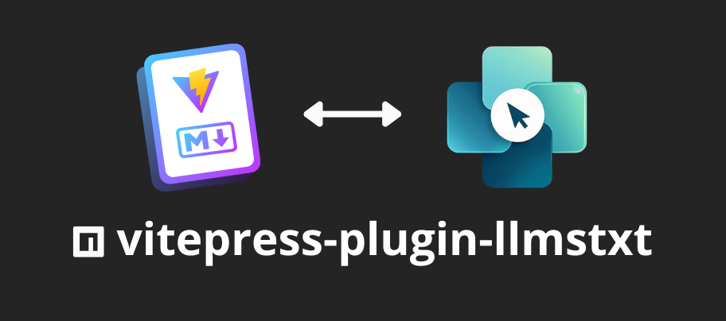

# VitePress Plugin LLMS Text
<!-- ALL-CONTRIBUTORS-BADGE:START - Do not remove or modify this section -->
[](#contributors-)
<!-- ALL-CONTRIBUTORS-BADGE:END -->



[](/LICENSE)
[](https://www.npmjs.com/package/vitepress-plugin-llmstxt)
[](https://www.npmjs.com/package/vitepress-plugin-llmstxt)

This plugin **automatically** generates **LLMS text files** (`llms.txt` and `llms-full.txt`) for VitePress projects. 
It can be used to create useful metadata files and provide structured information for large language models (_LLMs_).
 

## 🗂️ Index

- ✨ [Features](#-features)
- 🔑 [Installation](#-installation)
- 📖 [Usage](#-usage)
- ⚙️ [Configuration](#%EF%B8%8F-configuration)
- 💡 [Examples](#-examples)
- 💡 [Client Examples](#client-examples)
- 👨‍💻 [Contribute](#-contribute)


## ✨ Features

- **Simple** to use _(no configuration required)_.
- **lightweight** and **zero dependencies**.
- Automatically Generates a `llms.txt` of all pages.
- Automatically Generates a `llms-full.txt` of all pages.
- Automatically Generates `.md` files for each page.
- Supports **Ignoring** certain routes.
- Supports custom **frontmatter** addition.
- Supports dynamic routes and i18n routes.
- Supports **transformation** of page data via a callback.
- Supports for building only certain files.
- Generates a table of contents (**TOC**).
- Follows the https://llmstxt.org/ standard.
- Experimental support for **VitePress v2.0.0-alpha**.


> 💬 If you're using VitePress 2.x, please report any compatibility issues [here](https://github.com/angelespejo/vitepress-plugin-llmstxt/issues/6).


## 🔑 Installation

Install the plugin:

```bash
npm install vitepress-plugin-llmstxt
# or
pnpm install vitepress-plugin-llmstxt
# or
yarn add vitepress-plugin-llmstxt
# or
bun add vitepress-plugin-llmstxt
# or
deno add vitepress-plugin-llmstxt
```

## 📖 Usage

Import and use the plugin in your _VitePress_ configuration:

```typescript
import { defineConfig } from 'vitepress';
import llmstxtPlugin from 'vitepress-plugin-llmstxt';

export default defineConfig({
  vite: {
    plugins: [llmstxtPlugin()],
  },
});
```

## ⚙️ Configuration

This plugin requires no configuration, but if you need specific settings, it can be flexibly configured to suit any use case.

- 👉 [See types](https://github.com/angelespejo/vitepress-plugin-llmstxt/blob/main/packages/vitepress/src/types.ts)
- 👉 [See d.ts](https://unpkg.com/vitepress-plugin-llmstxt/dist/index.d.ts)

The plugin supports the following configuration options:

### `hostname` (string)

The base URL to use for generated links.  

#### Examples
```js
{
  hostname: 'https://example.org'
}
```

### `ignore` (string[])

An array of glob patterns to exclude from processing.  

- The plugin will ignore all files that match the pattern
- The files to ignore should be a global pattern of the local 'md' documentation files.

> **IMPORTANT**
> `vitepress-plugin-llmstxt` uses
> `import { createContentLoader } from 'vitepress'`
> to load **.md** files. Because of this, the pattern **must not** start with a leading slash (`/`).
> [Learn more](https://vitepress.dev/guide/data-loading#createcontentloader)

#### Examples

```js
{
  ignore: [ '**/guide/index.md' ] // Ignore only guide index.
}
```
```js
{
  ignore: [ '**/guide/core/*' ] // Ignore all core folder.
}
```
```js
{
  ignore: [ '**/guide/core/*', '**/guide/api/*' ] // Ignore multiple patterns (all core and api folder)
}
```

### `llmsFile` (boolean | object)

Whether to generate the main `llms.txt` file.  
**@default** `true`

If passed as an object, you can control additional options:

#### `indexTOC` (boolean | 'only-llms' | 'only-web' | 'only-llms-links' | 'only-web-links')
Controls the content of the table of contents inside the `llms.txt` file.

- `'only-llms'` - Only the title with LLMs links  
- `'only-web'` - Only the title with web links  
- `'only-llms-links'` - Only the LLMs links  
- `'only-web-links'` - Only the web links  
- `true` - Show both  
- `false` - No index included  

#### Examples

```js
{
  llmsFile: {
    indexTOC: 'only-llms'
  }
}
```

### `llmsFullFile` (boolean)

Whether to generate the extended `llms-full.txt` file.  
**@default** `true`

### `mdFiles` (boolean)

Whether to generate a `.md` file for each route.  
**@default** `true`

### `dynamicRoutes` (boolean)

Support vitepress [dynamic routes](https://vitepress.dev/guide/routing#dynamic-routes).
**@default** `true`

### `transform` (function)

A callback to transform each page's data before writing it.  

```ts
{
  transform?: (data: {
    page: LlmsPageData
    pages: LlmsPageData[]
    vpConfig?: VPConfig
    utils: {
      getIndexTOC: (type: IndexTOC) => string
      removeFrontmatter: (content: string) => string
    }
  }) => Promise<LlmsPageData> | LlmsPageData
}
```

You can use this to mutate `page.content`, add or remove metadata, or conditionally skip pages.

#### Examples 

```ts
{
  transform: async ({ page }) => {

    // Add a content before llms.txt content
    if (page.path === '/llms.txt')
      page.content = `Structured information designed to provide useful metadata to large language models (LLMs)\n\n` + page.content

    // Remove frontmatter from llms-full.txt
    if (page.path === '/llms-full.txt')
      page.content = utils.removeFrontmatter(page.content)

    // Add a title and an index table of contents in llms-full.txt
    if (page.path === '/llms-full.txt')
      page.content = '# LLMS Full\n\n' + utils.getIndexTOC('only-llms') + '\n\n' + page.content

    return page
  }
}
```

### `watch` (boolean)

Whether to watch for changes to the source files and regenerate the `llms.txt`, `llms-full.txt` and `.md` files.
**@default** `false`

> This feature is only enabled in **development mode**.

## 💡 Examples

```ts
import { defineConfig } from 'vitepress';
import llmstxtPlugin from 'vitepress-plugin-llmstxt';

export default defineConfig({
  vite: {
    plugins: [
      llmstxtPlugin({
        hostname: 'https://example.com',
        ignore: ['*/api/**/*'],
        llmsFile: {
          indexTOC: 'only-llms',
        },
        llmsFullFile: true,
        mdFiles: false,
        transform: ({ page, pages }) => {
          if (page.path === '/llms.txt') {
            page.content = `Structured information designed to provide useful metadata to large language models (LLMs)\n\n` + page.content;
          }
          return page;
        },
      })
    ],
  },
});
```

## Client examples

You can display your call information on the frontend.
Here's an example:

#### .vitepress/theme/components/llmstxt.vue

```html
<script setup>

import { useLLMsRouteData } from 'vitepress-plugin-llmstxt/client' 
import { useRoute, useData } from 'vitepress/client'
import { ref, watch } from 'vue'

const data     = useData()
const route    = useRoute()
const llmsPath = ref( useLLMsRouteData( route, data )?.path )

watch(
  route,
  newValue => llmsPath.value = useLLMsRouteData( newValue, data )?.path,
  { immediate: true },
)

</script>

<template>
  <div
    class="llmstxt-section"
    v-if="llmsPath"
  >
    <p class="outline-title">
      LLM Resources
    </p>
    <ul>
      <li>
        <a
          :href="llmsPath"
          target="_blank"
          class="VPLink link"
        >
          llms.txt
        </a>
      </li>
    </ul>
  </div>
</template>

<style>
  .llmstxt-section {
    margin: 25px 0px 5px 0px;
  }
  .llmstxt-section li {
    margin: 5px;
  }
  .llmstxt-section a {
    font-size: small;
    margin: 0;
    color: var(--vp-c-text-2);
    transition: color 0.5s;
  }
  .llmstxt-section a:hover {
    color: var(--vp-c-text-1);
    transition: color 0.25s;
  }
</style>
```

#### .vitepress/theme/index.{ts,js}

```js
import DefaultTheme from 'vitepress/theme'
import { h }        from 'vue'
import Llmstxt from './components/llmstxt.vue'

/** @type {import('vitepress').Theme} */
export default {
  extends : DefaultTheme,
  Layout( ) {
    return h( DefaultTheme.Layout, null, { 'aside-outline-after': () => h( Llmstxt ) } )
  },
}
```

## 👨‍💻 Contribute

`vitepress-plugin-llmstxt` is an open source project and its development is open to anyone who wants to participate.


- 🐛 [Report issues](https://github.com/angelespejo/vitepress-plugin-llmstxt/issues)
- 🚀 [Pull request](https://github.com/angelespejo/vitepress-plugin-llmstxt/pulls)
- ⭐️ [Star the repository](https://github.com/angelespejo/vitepress-plugin-llmstxt)
- ❤️ [Support](https://github.com/sponsors/angelespejo)
- 👀 [See code](https://github.com/angelespejo/vitepress-plugin-llmstxt/tree/main/src)


---

[](/LICENSE)
[](https://www.npmjs.com/package/vitepress-plugin-llmstxt)
[](https://www.npmjs.com/package/vitepress-plugin-llmstxt)

## Contributors ✨

Thanks goes to these wonderful people ([emoji key](https://allcontributors.org/en/reference/emoji-key/)):

<!-- ALL-CONTRIBUTORS-LIST:START - Do not remove or modify this section -->
<!-- prettier-ignore-start -->
<!-- markdownlint-disable -->
<table>
  <tbody>
    <tr>
      <td align="center" valign="top" width="14.28%"><a href="https://github.com/rhorenov"><br /><sub><b>Roman Hořeňovský</b></sub></a><br /><a href="https://github.com/angelespejo/vitepress-plugin-llmstxt/commits?author=rhorenov" title="Code">💻</a> <a href="https://github.com/angelespejo/vitepress-plugin-llmstxt/commits?author=rhorenov" title="Tests">⚠️</a></td>
    </tr>
  </tbody>
  <tfoot>
    <tr>
      <td align="center" size="13px" colspan="7">
        
          <a href="https://all-contributors.js.org/docs/en/bot/usage">Add your contributions</a>
        </img>
      </td>
    </tr>
  </tfoot>
</table>

<!-- markdownlint-restore -->
<!-- prettier-ignore-end -->

<!-- ALL-CONTRIBUTORS-LIST:END -->

This project follows the [all-contributors](https://github.com/all-contributors/all-contributors) specification. Contributions of any kind welcome!